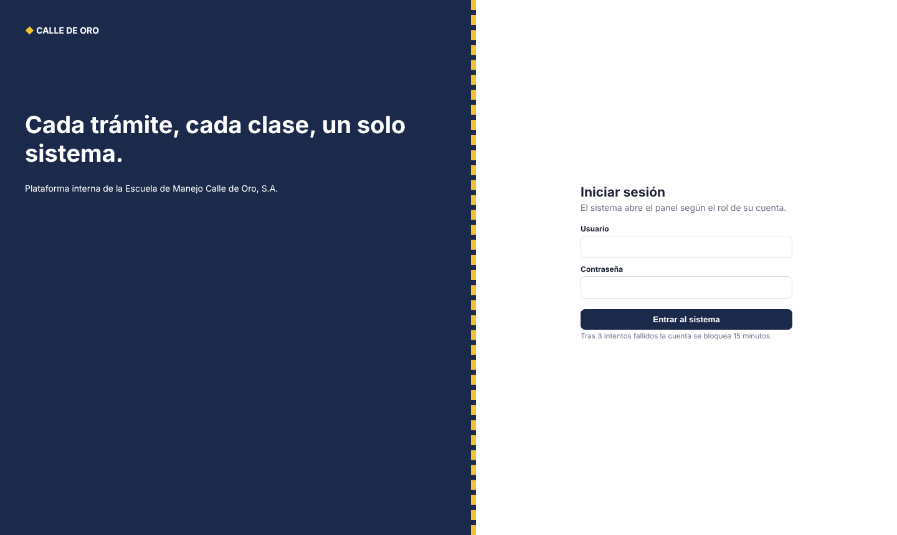
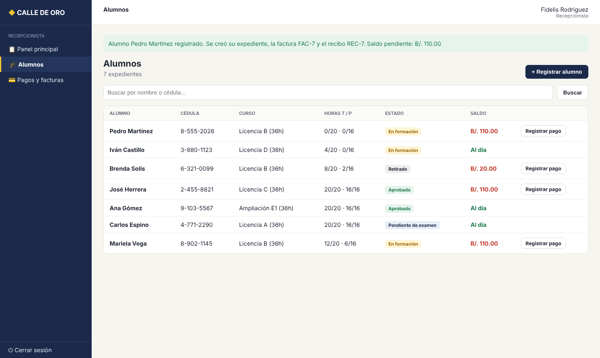
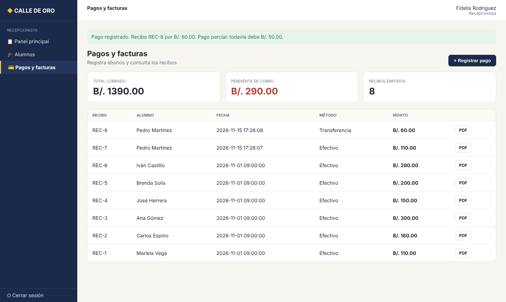
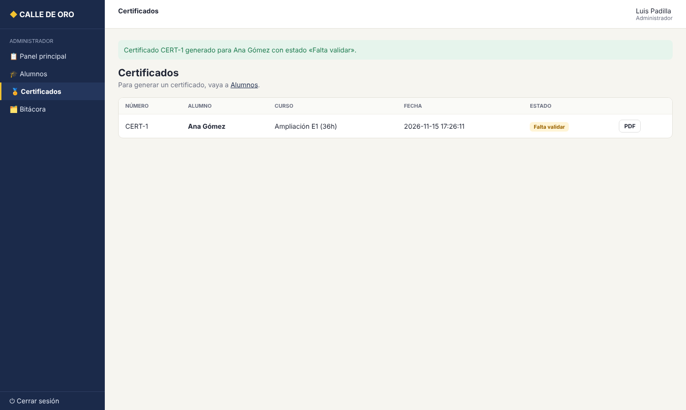

# Sistema de Gestión – Escuela de Manejo Calle de Oro, S.A.

Proyecto semestral de **Ingeniería de Software II** (UTP, FISC, grupo 1IL133, Dra. Elba Valderrama, II semestre 2026).
**Fase 3: Implementación** de los tres casos de uso aprobados.

**Equipo Codexa:** Javier Acuña, Alisson Lacayo, Elvis Li, Cristell Peters (coordinadora).



## Casos de uso implementados

| CU | Qué hace | Quién lo usa | Requisitos que cubre |
|---|---|---|---|
| CU-01 Registrar alumno | Crea el alumno, su expediente, su factura y el abono inicial (mínimo 50 %) | Recepcionista | RF-01, RF-04, RF-12 |
| CU-04 Pagos, facturas y recibos | Registra pagos totales o parciales, baja el saldo y genera el recibo en PDF | Recepcionista | RF-04 |
| CU-03 Generar certificado | Lo crea en estado "Falta validar" solo si el alumno está aprobado, tiene 20 h teóricas + 16 h prácticas y saldo 0 | Administrador | RF-03 |

Los tres están protegidos por el inicio de sesión y los roles (RF-08 y RF-09): bloqueo tras 3 intentos y cierre de sesión a los 15 minutos sin uso.

## Tecnologías

- **Python 3 + Flask**: servidor y reglas de negocio
- **HTML (Jinja2), CSS y JavaScript básicos**: pantallas basadas en el prototipo de Figma
- **SQLite**: base de datos (se crea sola al primer arranque)
- **ReportLab**: PDF del recibo y del certificado
- **pytest**: 19 pruebas automáticas

## Cómo ejecutarlo

Requisito: Python 3.10 o superior (al instalarlo, marcar **"Add Python to PATH"**).

Abrir una terminal en la carpeta `calle_de_oro` y escribir un comando a la vez:

```
python -m pip install -r requirements.txt
python run.py
```

Luego abrir **http://127.0.0.1:5000** en el navegador. Para apagarlo: `Ctrl + C`.

| Usuario | Contraseña | Rol |
|---|---|---|
| `recepcion` | `Recepcion2026!` | Recepcionista (CU-01 y CU-04) |
| `admin` | `Admin2026!` | Administrador (CU-03 y bitácora) |
| `instructor` | `Instructor2026!` | Instructor (para mostrar los permisos) |

La primera vez se crea la base de datos con datos de demostración. Para empezar de cero, borrar la carpeta `instancia` y volver a ejecutar `python run.py`.

### Datos de demostración

| Alumno | Estado | Horas T/P | Debe | Sirve para probar |
|---|---|---|---|---|
| Mariela Vega | En formación | 12/6 | B/. 110 | Pago (CU-04) y certificado rechazado por horas |
| Carlos Espino | Pendiente de examen | 20/16 | 0 | Certificado rechazado: no está aprobado |
| **Ana Gómez** | Aprobado | 20/16 | 0 | **Certificado generado** |
| José Herrera | Aprobado | 20/16 | B/. 110 | Certificado rechazado por saldo |

Cédula ya registrada, para probar el error de duplicado en CU-01: `8-902-1145`.

## Arquitectura

Cliente-servidor, con el servidor dividido en **3 capas** (igual que el diseño de la Fase 2):

```
calle_de_oro/
├── run.py                    arranca el sistema
├── config.py                 reglas configurables (50 %, 3 intentos, 15 min, 20 + 16 h)
├── requirements.txt
├── app/
│   ├── presentacion/         CAPA 1: rutas y control de permisos
│   ├── templates/            pantallas HTML
│   ├── static/               estilos.css y funciones.js
│   ├── negocio/              CAPA 2: un servicio por caso de uso, validaciones y PDF
│   └── datos/                CAPA 3: schema.sql y todo el SQL (repositorios.py)
├── tests/                    pruebas de CU-01, CU-03, CU-04 y seguridad
├── scripts/                  respaldo y prueba de carga de 30 usuarios
└── docs/                     guía, matriz de trazabilidad, ajustes y evidencia
```

## Pruebas

```
python -m pytest -v                 19 pruebas automáticas
python scripts\prueba_carga.py      30 usuarios a la vez (con el servidor encendido)
python scripts\respaldo.py          copia de seguridad de la base de datos
```

Resultado de la prueba de carga: promedio 0,07 s, máximo 0,19 s y 0 errores (el requisito pide 3 s).

## Evidencia

| CU-01 Registro exitoso | CU-04 Pago parcial | CU-03 Certificado generado |
|---|---|---|
|  |  |  |

Las 18 capturas y los resultados de las pruebas están en [`calle_de_oro/docs/evidencia`](calle_de_oro/docs/evidencia).

## Documentos

- [Guía de defensa](calle_de_oro/docs/GUIA_DEFENSA.md): qué hace cada archivo y preguntas típicas
- [Matriz de trazabilidad](calle_de_oro/docs/MATRIZ_TRAZABILIDAD.md): requisito → archivo → función → prueba
- [Ajustes de diseño](calle_de_oro/docs/AJUSTES_DISENO.md): cambios respecto a la Fase 2 y su justificación
- [Checklist de la rúbrica](calle_de_oro/docs/CHECKLIST_RUBRICA.md)
